

<h1 align="center">cyanote++</h1>

Multi-tab notes that save themselves · calculator · lunar calendar · <b>appointments &amp; calls</b> · photos &amp; voice notes

  <a href="https://cyan881990.github.io/download/cyanote-android.apk"><b>⬇ Download for Android (APK)</b></a> ·
  <a href="https://cyan881990.github.io/guide.html"><b>📖 Illustrated guide</b></a> ·
  <a href="https://cyan881990.github.io/privacy.html">Privacy Policy</a>

---

## 📣 Announcement: cyanote++ 1.1 (Oct 17, 2026)

New in 1.1: **appointments & call reminders with sound**, **tag an appointment from any line of a note** (the phone number is detected automatically), **reminder buttons Call · Snooze 10 min · Done**, **photos and voice notes inside notes** with a per-note manager, a **Calculator ⇄ Appointments** panel you can hide, **Notepad++-style line numbers** and a **word-wrap switch** (on by default). Two-column layout on tablets and landscape, 13 languages, light/dark mode.

Already installed? Tap **⬇ Update** at the top of the app, or ⋮ → *Check for updates*. Full illustrated guide: **[cyan881990.github.io/guide.html](https://cyan881990.github.io/guide.html)**.

**Guide in your language:** [English](https://cyan881990.github.io/guide.html?lang=en) · [Tiếng Việt](https://cyan881990.github.io/guide.html?lang=vi) · [Español](https://cyan881990.github.io/guide.html?lang=es) · [Português](https://cyan881990.github.io/guide.html?lang=pt) · [Français](https://cyan881990.github.io/guide.html?lang=fr) · [Deutsch](https://cyan881990.github.io/guide.html?lang=de) · [Bahasa Indonesia](https://cyan881990.github.io/guide.html?lang=id) · [ไทย](https://cyan881990.github.io/guide.html?lang=th) · [日本語](https://cyan881990.github.io/guide.html?lang=ja) · [한국어](https://cyan881990.github.io/guide.html?lang=ko) · [简体中文](https://cyan881990.github.io/guide.html?lang=zh) · [हिन्दी](https://cyan881990.github.io/guide.html?lang=hi) · [Русский](https://cyan881990.github.io/guide.html?lang=ru)

  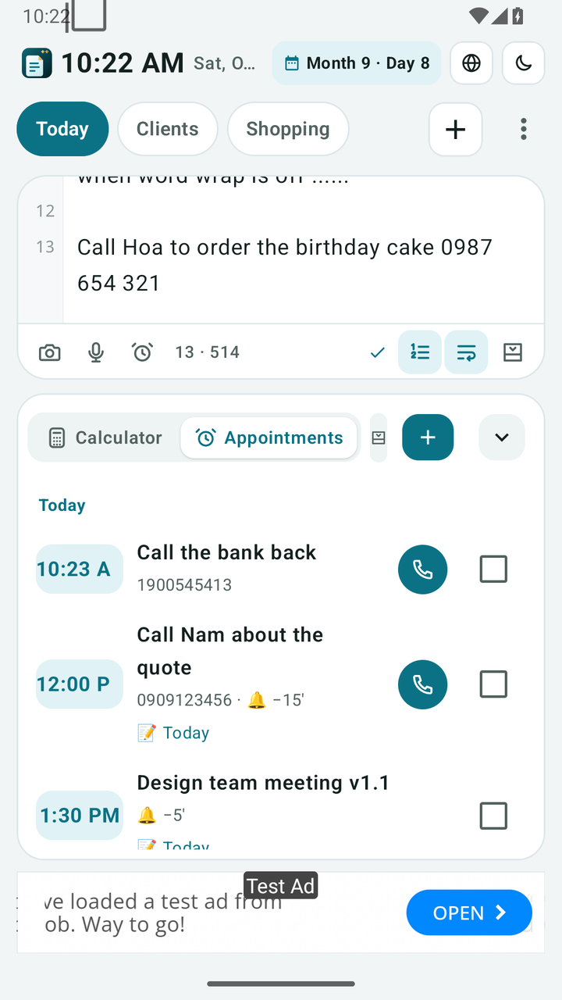
  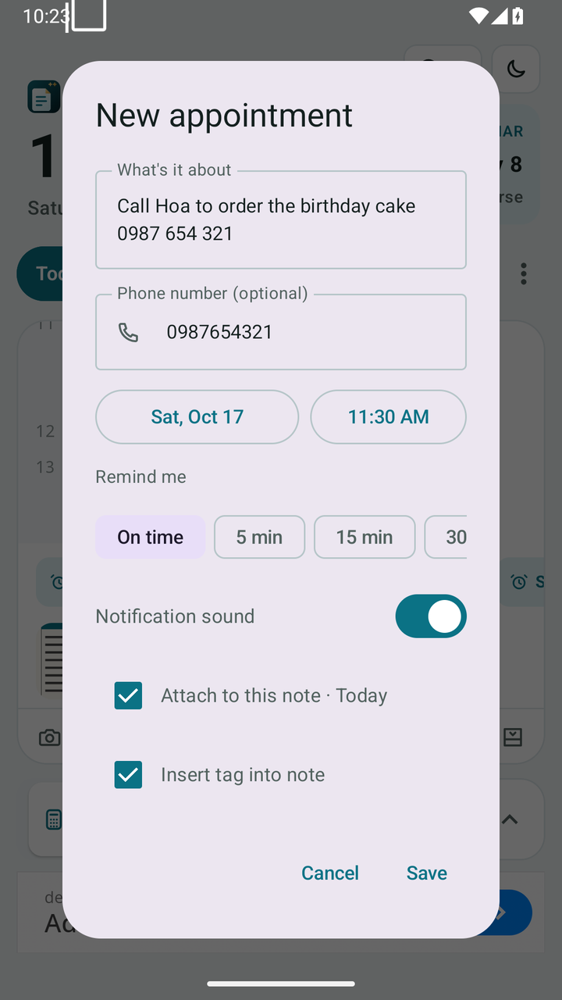
  
  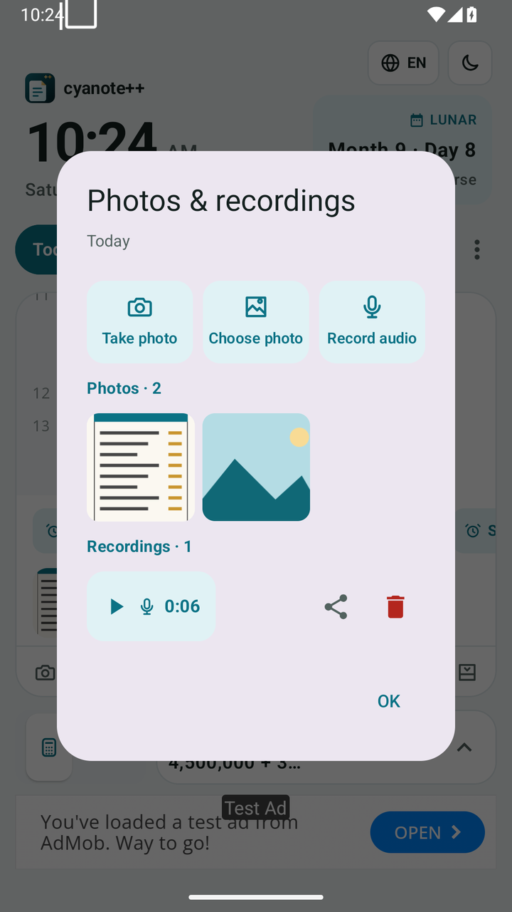

  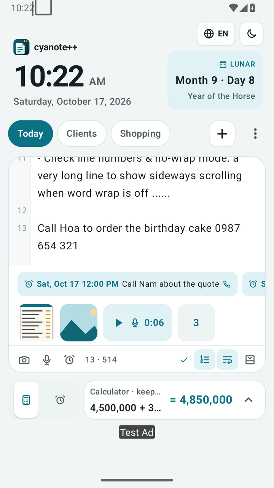
  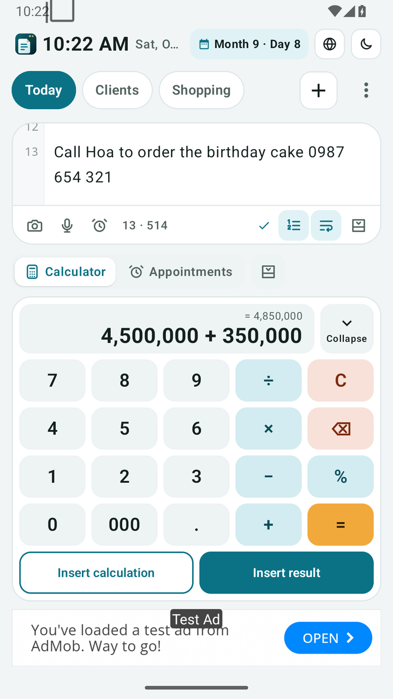
  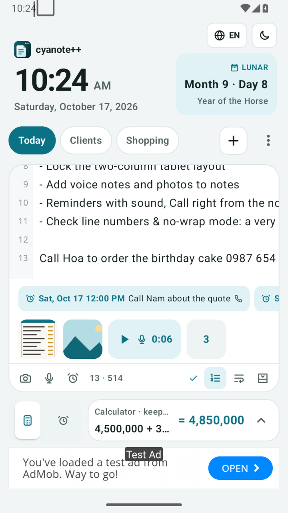
  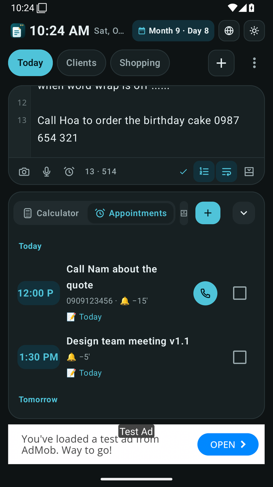

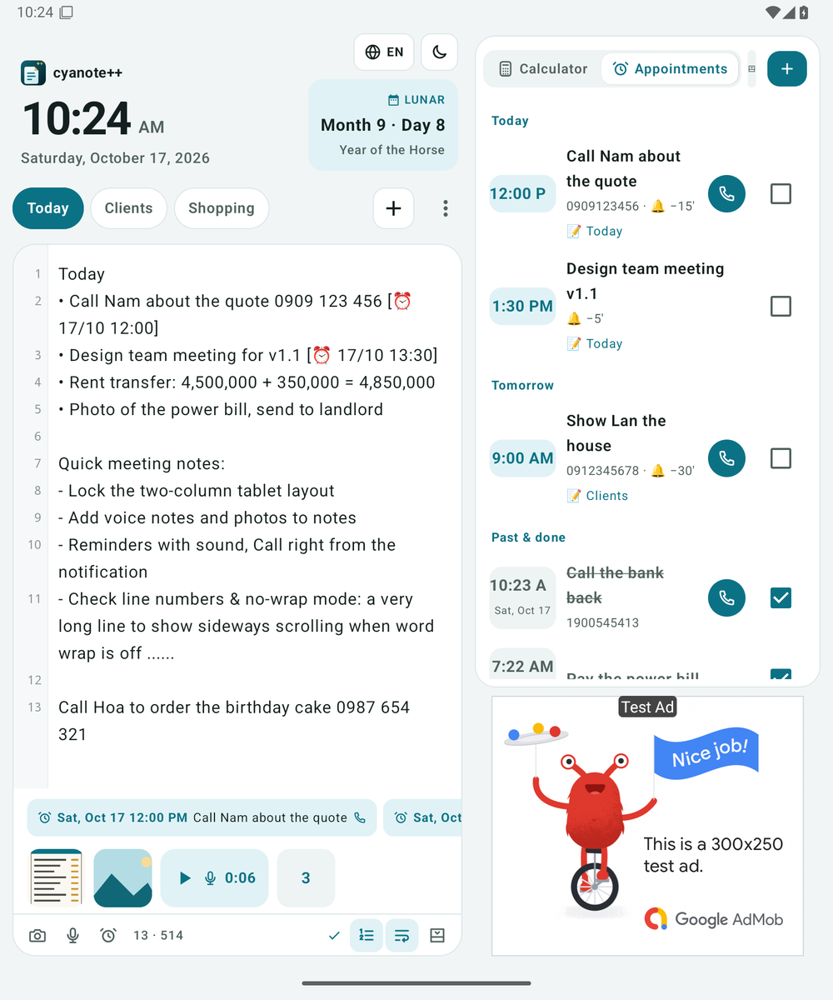

### Install

1. **Android**: download [`cyanote-android.apk`](https://cyan881990.github.io/download/cyanote-android.apk) → open it → allow *Install unknown apps*.
2. When you create your first appointment, tap **Allow** for notifications. Android 12+: turn on **Alarms & reminders** so reminders arrive on the exact minute.
3. Strong battery saver (Xiaomi, Oppo, Samsung…): set cyanote++ battery usage to *Unrestricted*.
4. **iOS**: beta through TestFlight; the App Store version updates itself.

### Privacy

Notes, appointments, photos and recordings **stay on your device**. No account, no server. *Call* only opens the dialer; the app **does not read your call log or contacts**. Full policy: [privacy.html](https://cyan881990.github.io/privacy.html).

---

## 📣 Thông báo: cyanote++ 1.1 (17/10/2026)

Bản 1.1 thêm **lịch hẹn & cuộc gọi có chuông**, **gắn lịch hẹn vào ghi chú**, **chụp ảnh và ghi âm dán vào ghi chú**, **số dòng như Notepad++** và **bật/tắt tự xuống dòng**. Bạn đã cài bản cũ thì mở app, bấm nhãn **⬇ Cập nhật** ở đầu màn hình (hoặc menu ⋮ → *Kiểm tra cập nhật*).

| | Tính năng mới | Cách dùng |
|---|---|---|
| ⏰ | **Lịch hẹn & cuộc gọi** | Bảng dưới → *Lịch hẹn* → **+**. Nhóm theo Hôm nay · Ngày mai · Sắp tới · Đã xong, bấm 📞 để gọi |
| 🏷️ | **Gắn nhanh vào ghi chú** | Đặt con trỏ ở dòng "Gọi anh Nam 0909…", bấm ⏰ dưới ghi chú: app tự lấy nội dung và số điện thoại, chèn thẻ `[⏰ 18/10 15:30]` |
| 🔔 | **Thông báo có chuông** | Đúng giờ hoặc nhắc trước 5/15/30/60 phút. Nút **Gọi · Báo lại 10 phút · Xong** ngay trên thông báo |
| 📷 | **Ảnh** | Bấm 📷 → *Chụp ảnh* / *Chọn ảnh*. Ảnh hiện thành dải trong ghi chú |
| 🎤 | **Ghi âm** | Bấm 🎤 → *Dừng & lưu*. Bấm để nghe lại |
| 🗂️ | **Quản lý ảnh & ghi âm** | Menu ⋮ → *Ảnh & ghi âm*: xem, chia sẻ, xoá |
| 🧮 | **Máy tính ⇄ Lịch hẹn** | Đổi qua lại ở bảng dưới, hoặc **ẩn bảng** để ghi chú rộng hơn |
| #️⃣ | **Số dòng · Tự xuống dòng** | Nút `1 2 3` và `↩` dưới ghi chú (mặc định tự xuống dòng) |

  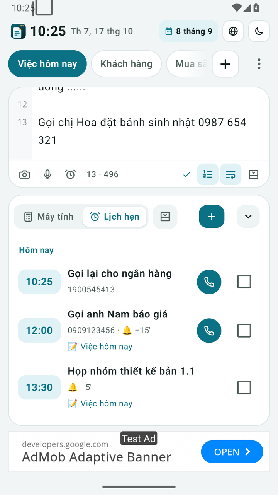
  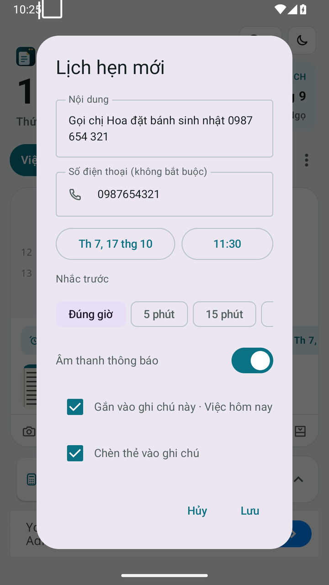
  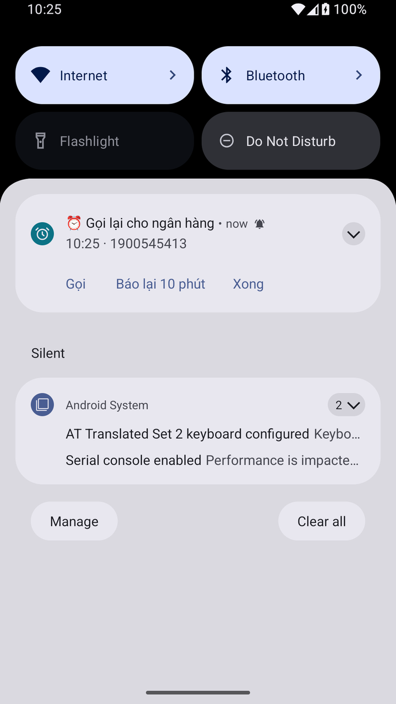
  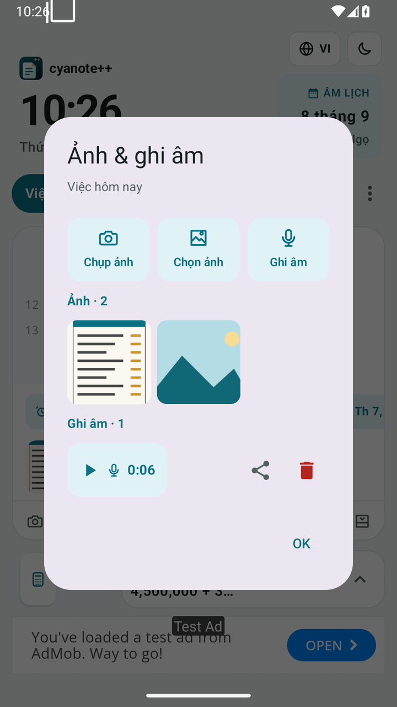

  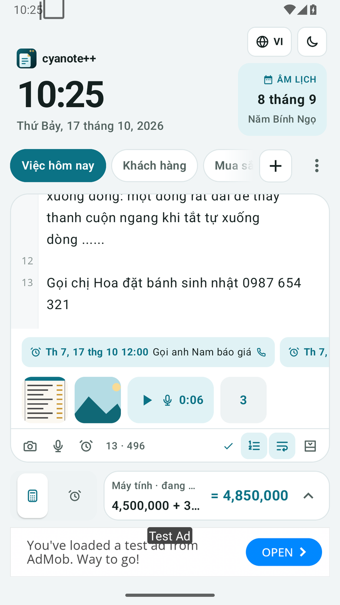
  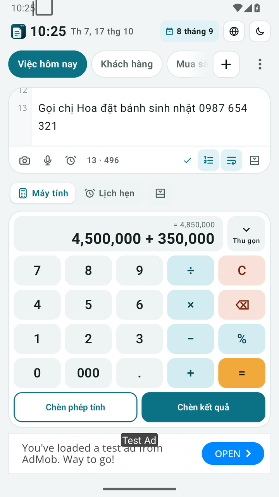
  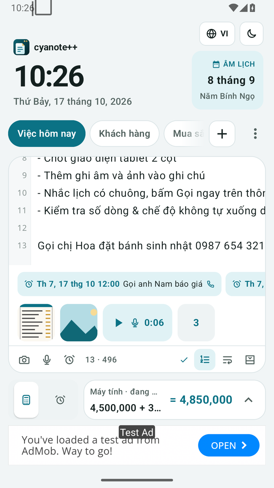
  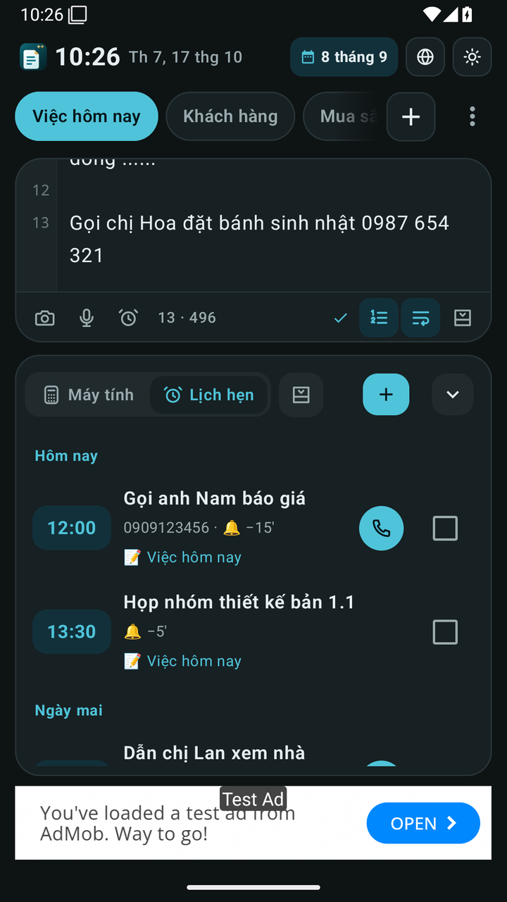

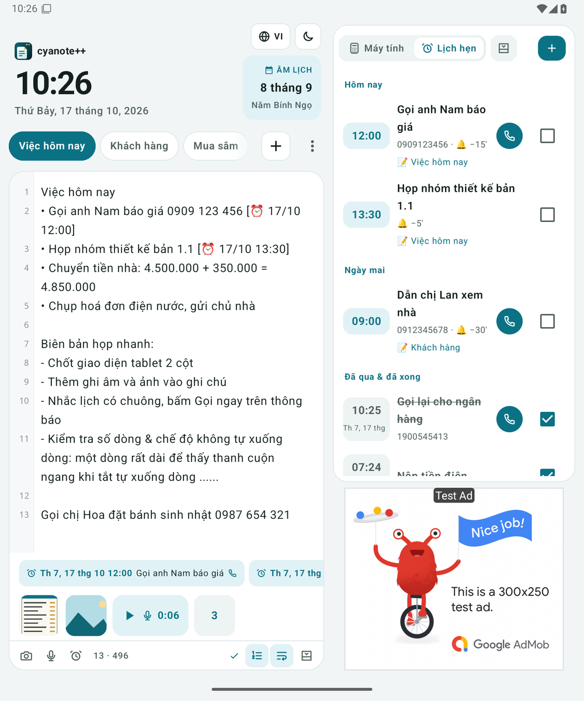

### Cài đặt

1. **Android**: tải [`cyanote-android.apk`](https://cyan881990.github.io/download/cyanote-android.apk) → mở file → cho phép *Cài ứng dụng không rõ nguồn gốc*.
2. Lần đầu tạo lịch hẹn, bấm **Cho phép** thông báo. Android 12+: bật **Báo thức và lời nhắc** để nhắc đúng phút.
3. Máy tiết kiệm pin mạnh (Xiaomi, Oppo, Samsung…): đặt pin của cyanote++ là *Không giới hạn*.
4. **iOS**: bản thử nghiệm qua TestFlight; bản App Store tự cập nhật.

### Quyền riêng tư

Ghi chú, lịch hẹn, ảnh và ghi âm **chỉ lưu trên máy bạn**. Không có tài khoản, không có máy chủ. Nút *Gọi* chỉ mở trình gọi điện; app **không đọc nhật ký cuộc gọi hay danh bạ**. Xem đầy đủ: [privacy.html](https://cyan881990.github.io/privacy.html).

---

© 2026 cyanote++ · <a href="mailto:cyan881990@gmail.com">cyan881990@gmail.com</a> · Source code is private, all rights reserved.
